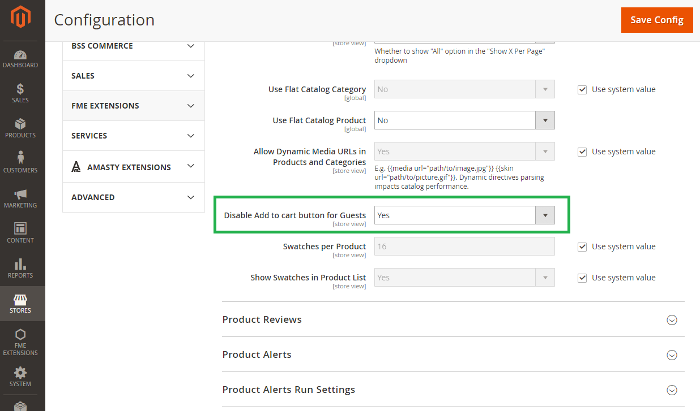

# Magento 2 - Disable add to cart button for guest

## Overview
This module enables the possibility to disable the Add to Cart button on product and category pages for customers who are not logged in.
It is useful for B2B stores where guest users should not be able to add products to the cart.

## Compatibility

| Module version | Magento version | PHP version           |
|----------------|-----------------|-----------------------|
| 2.0.x          | 2.4.6 – 2.4.8   | 7.0 – 8.4             |
| 1.0.x          | 2.1 – 2.3       | 7.0 – 7.2             |

## Installation

```bash
composer require sbodak/magento2-b2b-disable-add-to-cart-button-for-guest
php bin/magento module:enable Bodak_DisableAddToCart
php bin/magento setup:upgrade
php bin/magento cache:clean
```

## Configuration

1. Go to the Magento admin interface.
2. Navigate to **Stores > Configuration > Catalog > Catalog**.
3. Under the **Storefront** tab find the **Disable Add to cart button for Guests** option.
4. Set it to **Yes** to activate the plugin.

### Module configuration — administration panel


### Removed Add to Cart button in catalog — frontend view


### Removed Add to Cart button on product page — frontend view


## Running tests

```bash
composer install
vendor/bin/phpunit
```

## Uninstall

```bash
composer remove sbodak/magento2-b2b-disable-add-to-cart-button-for-guest
```

## Changelog

See [CHANGELOG.md](CHANGELOG.md).

## License
[MIT License](LICENSE)
